<!-- ✦ Siddhi Singh · github.com/siddhisingh9 ✦ -->

<a href="https://siddhisingh9.github.io/">
  
</a>

  
  
  
  

 


I'm **Siddhi**, a third-year **Data Science & AI** student at **IIT Bhilai**. Most of my work sits where ML meets engineering: training models, then turning them into services people can actually use.

- 🔭 &nbsp;Working on **missing-modality multimodal learning**: retrieval-augmented prompts + mixture-of-experts
- 💼 &nbsp;Incoming **Technology Intern at HSBC**, Summer 2027
- 🌱 &nbsp;**Flipkart mentee**, Top 200 of 27,000+
- 🧑‍🏫 &nbsp;Mentor (AI/ML) at **OpenLake**, IIT Bhilai's open-source society
- 🎨 &nbsp;UI/UX Head at **DesignX**, so I care how things look as much as how they work
- 🏓 &nbsp;Off the keyboard: table tennis, sitcoms, and the eternal hunt for good shawarma

 
 


<!-- Swap each href below for the project's own repo link -->
<a href="https://github.com/siddhisingh9?tab=repositories">
  
</a>

  <a href="https://github.com/siddhisingh9?tab=repositories"></a>
  <a href="https://github.com/siddhisingh9?tab=repositories"></a>

<a href="https://github.com/siddhisingh9?tab=repositories"><code>more on GitHub →</code></a>


  

 



  



  


  
  

  
  

<picture>
  <source media="(prefers-color-scheme: dark)" srcset="https://raw.githubusercontent.com/siddhisingh9/siddhisingh9/output/github-snake-dark.svg"/>
  <source media="(prefers-color-scheme: light)" srcset="https://raw.githubusercontent.com/siddhisingh9/siddhisingh9/output/github-snake.svg"/>
  
</picture>

  

Open to mentorship conversations, collaborations on AI/ML projects, or just a chat about what I'm building. My inbox is the fastest way to reach me: **[siddhiwrite@gmail.com](mailto:siddhiwrite@gmail.com)**

  

